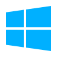

# NotMonk Client
<sub> Powered by iiTemplate </sub>

Another Stupid Menu For Gorilla Tag.

NotMonk Client is a simple project for me to learn C# and not have my code like AI slop (it's not I swear T-T)

Please Note: NotMonk Client is ***HEAVILY*** inspired by [Poison](https://github.com/heycanihavethis/Poison) and a lot of scripts show that

<sub>*NONE OF THE CODE IS DIRECTLY TAKEN FROM POISON, ALL OF IT IS CHANGED IN SOME WAY*</sub>
#

## Info [ and a Q&A thing ig ]
<sub>ideas from Poison T-T</sub>
<details>
  <summary><b>Why A Menu?</b></summary>

Ever since I heard what *"ii's Stupid Menu"* I've always been interested in modding, it ended up learning what gtag copies were and then I started modding them and I ***really*** wanted to make my own menu, which is why this is a thing \:D

</details>

<details>
  <summary><b>Can I Use This Code</b></summary>

YES! But as everything good in life you *MUST* follow some simple rules

- like *Poison* your project **MUST** be open source
- GIVE. CREDIT.*
- No Viruses/Malware
- Follow the [GPL 3.0 LICENSE](https://www.gnu.org/licenses/gpl-3.0.html)

<sub>* If the script is marked in the code with a ```/* CRED: [DEV] */``` CREDIT. THAT. DEV. NOT ME</sub>

</details>

<details>
  <summary><b>Headset Compatibility</b></summary>

| Headset     | Menu | Tested? |
|-------------|------|---------|
| Rift/Rift S |????? | ❌ NO  |
| Quest 2     |Works | ✔️ YES  |
| Quest 3     |????? | ❌ NO  |
| Quest 3s    |Works | ✔️ YES  |
| Pico (any)  |????? | ❌ NO  |
| Valve Index |????? | ❌ NO  |
| HTC (any)   |????? | ❌ NO  |

<sub>If you want to share your tests dm me on discord @notmonk.idi0t or join our [server](https://discord.gg/qAW5Py7p4f)</sub>

</details>

<details>
  <summary><b>OS Compatibility</b></summary>

| OS                                                 | Menu | Tested? |
|----------------------------------------------------|------|---------|
| |Works | ✔️ YES  |
| |Works | ✔️ YES  |
|     |????? | ❌ NO  |
|     |????? | ❌ NO  |

<sub>If you want to share your tests dm me on discord @notmonk.idi0t or join our [server](https://discord.gg/qAW5Py7p4f)</sub>

</details>

#

> [!NOTE]
> This Menu is not affiliated with Gorilla Tag or Another Axiom LLC and is not endorsed or funded by Another Axiom.
> Gorilla Tag is a trademark of Another Axiom INC. I do not claim rights to any copyrighted, trademarked, or reserved terms.
> Windows 10 & 11, Linux, Apple, and Branch icon by [Icons8](https://icons8.com)